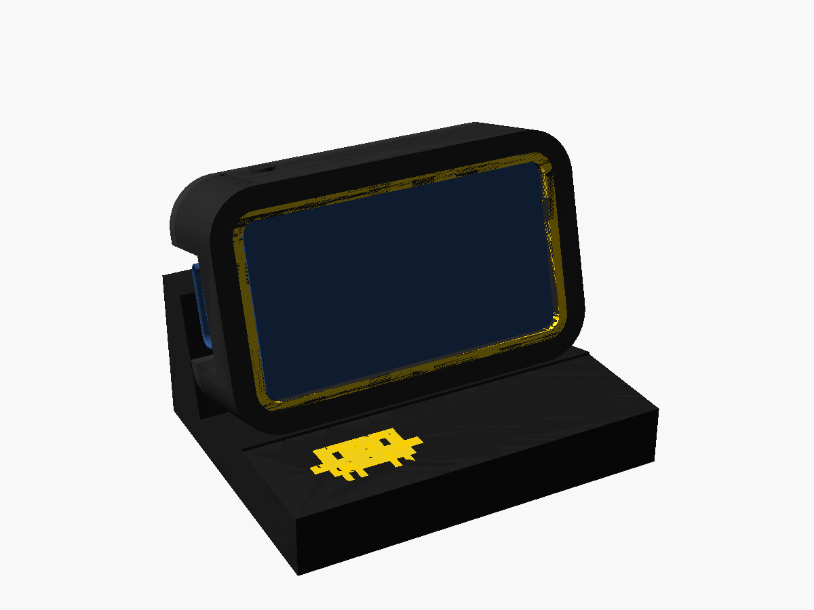

# Desk stand for the display

A three-part desk stand for the Waveshare ESP32-C6-LCD-1.47 running the Claude Code display:
- **Screen:** leans back 15°, upright with USB-C on the left.
- **Board:** snaps in without screws.
- **BOOT button:** printed into the top edge.
- **Colours:** black body; a yellow frame around the screen and a yellow pixel Clawd on the front ledge.



## Print it (Bambu Lab A1 + AMS)

1. Open **`out/stand.3mf`** in Bambu Studio. The project already has the following set up; check the AMS slots match:
   - printer: A1, 0.4 mm nozzle;
   - process: 0.20 mm Standard;
   - filaments: 1 = black PLA, 2 = yellow PLA;
   - plate: Textured PEI;
   - supports: off.
2. Slice and print.

| | |
|---|---|
| Time | ~40 min (Bambu Studio CLI estimate) |
| Filament | ~13 g black, ~2.7 g yellow (most of the yellow is purge) |
| Colour swaps | 8, only in the first 3 layers and 3 layers of the ledge |
| Supports | none |

**Parts and how they print:**
- **bezel:** face down. The yellow frame is inlaid flush in its first three layers.
- **back:** flat on its back.
- **base:** flat. The yellow Clawd is inlaid in the ledge top.

Fallback STLs are in `out/` if you'd rather set it up yourself.

## Assemble

1. Lay the board face down into the bezel. The switch sides slide into their slots, BOOT on the side with the flexible tab.
2. Press the back cover in. Its four pins locate in the board's M2 nuts, and two snap bumps per side click into the bezel.
3. Drop the case into the base, USB-C on the left, and plug in the cable.
4. **BOOT** is the small dome on the top edge. The first time, press it firmly once: you'll feel a small click as the
   printed tie at the free end of the button tab breaks (it holds the tab's first layer while printing). If it
   won't break, run a craft knife through the short slot at the end of the tab. After that it's a normal button
   (switch session; long press toggles high/low brightness).

## Tuning

Everything is parametric in `stand.scad` (OpenSCAD customizer):

| Symptom | Change |
|---|---|
| Board too tight in the bezel | `clear` 0.20 → 0.25 |
| Back cover falls out | `snap` 0.35 → 0.45 |
| Back cover too hard to fit | `snap` 0.35 → 0.25 |
| Case loose / tight in the base | `base_clear` |
| Different lean | `tilt` |
| BOOT tie too hard to break | `tie` 0.2 → 0 (then expect a slicer warning and a slightly rough tab edge) |

## Rebuild and checks

```sh
uv run python fetch_reference.py                       # board model (not in git), see credits
for p in bezel bezel_inlay back base base_inlay; do openscad -o out/$p.stl -D "part=\"$p\"" stand.scad; done
uv run python check.py                                 # fit, cradle, stability, overhangs, thin walls
uv run python make_3mf.py --slice                      # Bambu project + a real slice with Bambu Studio's CLI
uv run python make_makerworld.py                       # upload package in makerworld/
uv run python make_cover.py                            # 4:3 cover, with makerworld/screen.png (from the bridge's /shot) on the screen
```

`check.py` must print `ALL CHECKS PASSED`. It verifies:
- **Fit:** the reference board inside the case, with no contact.
- **Cradle:** the case in the base, 0.25 mm clearance all round.
- **Stability:** the stand doesn't tip, even when BOOT is pressed.
- **Overhangs:** each part in its print orientation has no overhang steeper than 45°, apart from features no wider than 0.8 mm.
- **Walls:** no sliver thinner than 0.4 mm.
- **Meshes:** watertight, also checked with the `3d-print` skill's validator.

Previews come from the `openscad` skill (`multi-preview.sh`). `render_assembly.scad` renders the exported meshes themselves.

## Credits

The board dimensions come from the **ESP32-C6-LCD-1.47 Reference CAD Model** by **x_giedrius_x**
(<https://www.printables.com/model/1633740-esp32-c6-lcd-147-reference-cad-model>, CC BY-NC-SA). It was used for measurements and collision checks only and is not redistributed here.
